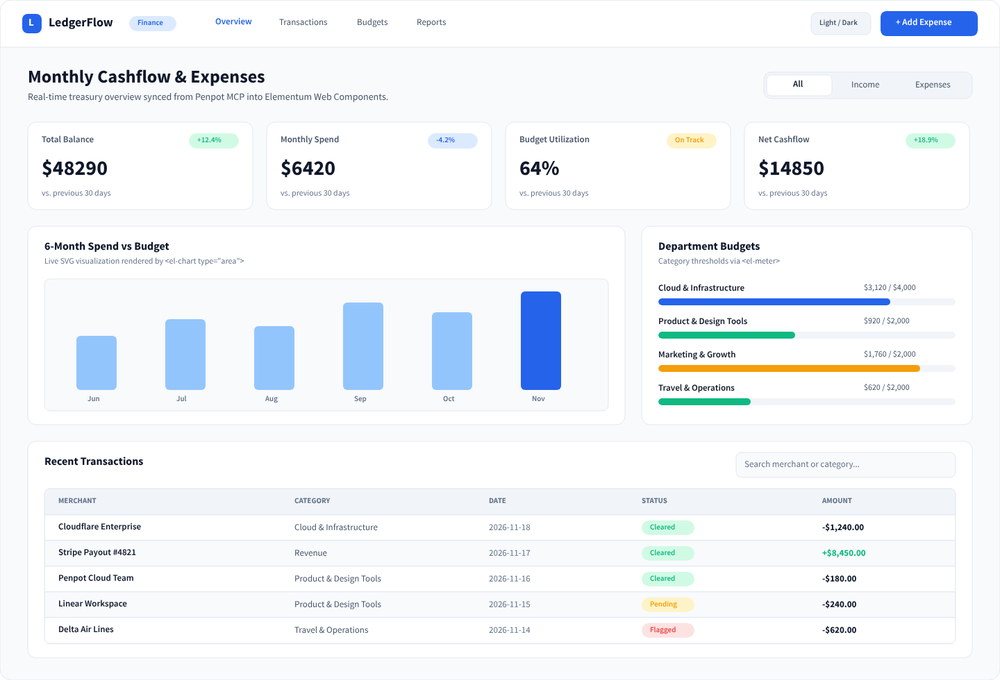
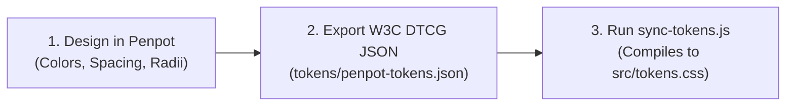

# Penpot Design System & MCP Workflow (Free & Open-Source)

> **Why Penpot?** While Figma requires paid subscriptions for advanced design token variables and organization features, **[Penpot](https://penpot.app)** ([design.penpot.app](https://design.penpot.app)) is 100% free, open-source, web-based, and natively uses standard web technologies (SVG, CSS flexbox/grid, and the **W3C Design Tokens Community Group (DTCG)** format).

Elementum supports a **two-way Penpot workflow** with zero runtime dependencies:
1. **Code → Penpot (MCP Sync)**: Generate all **54 W3C DTCG tokens**, **28 library colors**, and **105 master components** (across 8 categories) directly inside a live Penpot file via the **Penpot MCP Server** (`tools/sync-penpot-mcp.js`).
2. **Penpot → Code (Token Compiler)**: Export W3C DTCG JSON from Penpot to `tokens/penpot-tokens.json` and compile directly into `src/tokens.css` (`tools/sync-tokens.js`).

### Useful Penpot Links
- **Live Elementum LedgerFlow Design (Penpot Share)**: [Open in Penpot Viewer](https://design.penpot.app/?screen=viewer&file-id=42288968-6e5e-808d-8008-f77162b618ca&page-id=d8ded059-05ee-80c0-8008-f774c97dd053&section=interactions&index=0&share-id=8218fc5e-f68d-4bab-8fd7-283dd92586e8)
- **Penpot Web App**: [https://design.penpot.app](https://design.penpot.app)
- **Penpot Homepage & Docs**: [https://penpot.app](https://penpot.app)
- **Penpot Libraries & Templates**: [https://penpot.app/libraries-templates](https://penpot.app/libraries-templates)
- **Penpot Hosted MCP Stream Endpoint**: `https://design.penpot.app/mcp/stream?userToken=<YOUR_PENPOT_MCP_TOKEN>`

---

## 1. Code → Penpot: Automated MCP Design System Sync

Elementum ships [`tools/sync-penpot-mcp.js`](../tools/sync-penpot-mcp.js) (`npm run penpot:mcp`), which connects to Penpot's hosted or local MCP HTTP stream (`execute_code`) and builds the complete Elementum Design System inside your open Penpot file.

### Prerequisites
1. Open or create a design file in **[Penpot](https://design.penpot.app)**.
2. Open the **Penpot MCP Plugin** inside that file so your browser session is actively connected to the Penpot MCP server.
3. Copy your personal MCP stream URL (`https://design.penpot.app/mcp/stream?userToken=<YOUR_PENPOT_MCP_TOKEN>`) or `userToken`.

> **Security Note:** Never hardcode or commit your personal `userToken` JWT into source control, documentation, or public repositories. Always pass it via environment variables (`PENPOT_MCP_URL` or `PENPOT_MCP_TOKEN`) or CLI flags at runtime.

### Running the Sync

```bash
# Option A: Pass the full Penpot MCP stream URL
npm run penpot:mcp -- --url "https://design.penpot.app/mcp/stream?userToken=<YOUR_TOKEN>"

# Option B: Pass just the token (automatically targets design.penpot.app/mcp/stream)
npm run penpot:mcp -- --token "<YOUR_TOKEN>"

# Option C: Use environment variables (recommended for CI / local shells)
# PowerShell:
$env:PENPOT_MCP_URL = "https://design.penpot.app/mcp/stream?userToken=<YOUR_TOKEN>"
npm run penpot:mcp

# Bash / Zsh:
PENPOT_MCP_URL="https://design.penpot.app/mcp/stream?userToken=<YOUR_TOKEN>" npm run penpot:mcp

# Option D: Dry run (validates token & component scripts without connecting)
npm run penpot:mcp -- --dry-run
```

### CLI Flags & Environment Variables

| Option / Env Var | Description |
| :--- | :--- |
| `--url <url>` / `PENPOT_MCP_URL` | Full Penpot MCP HTTP stream endpoint (e.g., `https://design.penpot.app/mcp/stream?userToken=...` or a self-hosted MCP URL). |
| `--token <jwt>` / `PENPOT_MCP_TOKEN` | Penpot MCP `userToken`; automatically constructs `https://design.penpot.app/mcp/stream?userToken=<token>`. |
| `--dry-run` | Builds and validates the generated Penpot scripts locally and prints counts/byte sizes without calling Penpot. |

### What Gets Generated in Penpot
Running `npm run penpot:mcp` creates or updates:
- **Page**: `Elementum Design System` (arranged on 113 non-overlapping boards: 8 category headers + 105 component cards in a 3-column grid).
- **Design Token Sets (54 tokens total)**:
  - `Elementum Core` (active): 9 dimension/radius/spacing tokens
  - `Elementum Light` (active): 28 light-mode semantic, surface, step, and chart color tokens
  - `Elementum Dark` (inactive, ready to toggle): 17 dark-mode override tokens
- **Library Colors**: 28 local color swatches.
- **Library Components (105 master components across 8 categories)**:
  - `Actions & Buttons` (5)
  - `Forms & Inputs` (22)
  - `Data Display` (16)
  - `Feedback & Status` (8)
  - `Overlays & Dialogs` (10)
  - `Navigation` (16)
  - `Layout & Primitives` (23)
  - `AI & Specialist` (5)

---

## 2. End-to-End Case Study: LedgerFlow (Penpot → Elementum MCP Codegen)

To demonstrate the full **Design → MCP → Live Web Components** loop, Elementum includes a complete reference app (**LedgerFlow**, a fintech cashflow & expense dashboard) designed in Penpot and compiled directly into zero-dependency Web Components.



- **Live Penpot Design (Read-Only Share)**: [View LedgerFlow in Penpot](https://design.penpot.app/?screen=viewer&file-id=42288968-6e5e-808d-8008-f77162b618ca&page-id=d8ded059-05ee-80c0-8008-f774c97dd053&section=interactions&index=0&share-id=8218fc5e-f68d-4bab-8fd7-283dd92586e8)
- **Live Generated App**: [`examples/ledgerflow.html`](../examples/ledgerflow.html)
- **Penpot App Designer CLI**: [`tools/design-ledgerflow-penpot.js`](../tools/design-ledgerflow-penpot.js) (`npm run penpot:design-app`)
- **Penpot → Elementum Codegen CLI**: [`tools/penpot-to-elementum.js`](../tools/penpot-to-elementum.js) (`npm run penpot:generate`)

### How the Pipeline Works
1. **Annotate Penpot Layers with Elementum Tags**: Name component boards in Penpot using `el-*` tag annotations (e.g., `el-navbar | brand="LedgerFlow" badge="Finance"`, `el-card | section="kpi" title="Total Balance"`, `el-meter | label="Cloud & Infrastructure" value="78"`).
2. **Design or Open in Penpot**:
   ```bash
   # Optional: scaffold the LedgerFlow reference design in a connected Penpot file
   npm run penpot:design-app -- --url "https://design.penpot.app/mcp/stream?userToken=<YOUR_TOKEN>"
   ```
3. **Inspect via Penpot MCP & Generate Elementum HTML**:
   ```bash
   npm run penpot:generate -- \
     --url "https://design.penpot.app/mcp/stream?userToken=<YOUR_TOKEN>" \
     --page "LedgerFlow App" \
     --out examples/ledgerflow.html \
     --export-png docs/assets/ledgerflow-penpot.png
   ```
4. **Automatic Validation & Reactivity**:
   - Validates all **15 discovered tags** against Elementum's catalog (`el-badge`, `el-button`, `el-card`, `el-chart`, `el-dialog`, `el-drawer`, `el-input`, `el-meter`, `el-navbar`, `el-number-flow`, `el-segmented-control`, `el-select`, `el-table`, `el-theme-switch`, `el-toaster` — `0` unknown tags).
   - Exports a PNG snapshot of the Penpot artboard via `export_shape` (`docs/assets/ledgerflow-penpot.png`).
   - Wires live micro-signals (`signal`, `computed`, `effect`) for transaction filtering, `<el-drawer>` row inspection, `<el-dialog>` FACE expense creation, live `<el-number-flow>` KPI updates, and `<el-toaster>` notifications.

---

## 3. Penpot → Code: The 3-Step Token Pipeline



### Step 1: Define Tokens in Penpot
In your Penpot project:
1. Open the **Assets & Design Tokens** panel on the left sidebar.
2. Define your color palette, radii, and typography scales.
3. Group tokens under logical categories (e.g. `color.primary`, `radius.lg`, `spacing.md`).

### Step 2: Export Token JSON
1. Click the **Export Tokens** button in Penpot's asset panel.
2. Select **Design Tokens (DTCG JSON)**.
3. Save the exported file into your project as:
   ```
   tokens/penpot-tokens.json
   ```

### Step 3: Compile into Elementum CSS Tokens
Run the Elementum token sync script:

```bash
node tools/sync-tokens.js tokens/penpot-tokens.json
```

This compiles your tokens into `src/tokens.css`, automatically generating:
- **Light & Dark Mode** CSS custom properties (`--el-*`).
- **Physical Spring Easing Curves**:
  ```css
  --el-ease-out-expo: cubic-bezier(0.16, 1, 0.3, 1);
  --el-transition-fluid: 280ms var(--el-ease-out-expo);
  ```
- **Layered Ambient Elevation Shadows** (replacing flat solid borders):
  ```css
  --el-shadow-subtle: 0 1px 2px 0 rgba(0, 0, 0, 0.05);
  --el-shadow-card: 0 1px 3px rgba(0, 0, 0, 0.06), 0 8px 16px -4px rgba(0, 0, 0, 0.04);
  --el-border-translucent: rgba(15, 23, 42, 0.08);
  ```

---

## 3. Penpot Token Structure (W3C DTCG Standard)

Penpot exports design tokens in the official W3C format using `$value` and `$type` keys:

```json
{
  "color": {
    "primary": {
      "$value": "#2563eb",
      "$type": "color",
      "description": "Primary brand accent"
    },
    "surface": {
      "base": {
        "$value": "#ffffff",
        "$type": "color"
      },
      "muted": {
        "$value": "#f8fafc",
        "$type": "color"
      }
    }
  },
  "radius": {
    "md": {
      "$value": "8px",
      "$type": "dimension"
    },
    "xl": {
      "$value": "16px",
      "$type": "dimension"
    }
  }
}
```

The Elementum synchronizer (`tools/sync-tokens.js`) natively accepts both:
1. **Penpot DTCG standard format** (`$value` and `$type`)
2. **Figma variables export format** (`value` and `type`)

---

## 4. Banishing the "AI Look" with Penpot Tokens

When designing in Penpot for Elementum, adhere to these three core rules:

| Common Generic UI Pitfall | Penpot & Elementum Best Practice |
| :--- | :--- |
| Flat, opaque `#e2e8f0` 1px borders everywhere | Use **`--el-border-translucent`** (`rgba(15, 23, 42, 0.08)`) with multi-layer ambient box shadows |
| Abrupt jumps when switching numbers/prices | Connect state to **`<el-number-flow>`** for fluid slot-machine rolling animations |
| Standard linear/ease transitions | Apply **`--el-ease-out-expo`** (`cubic-bezier(0.16, 1, 0.3, 1)`) for tactile physical damping |

---

## 5. Penpot Community Templates

You can duplicate free community templates directly into your Penpot account:
1. Visit **[Penpot Libraries & Templates](https://penpot.app/libraries-templates)**.
2. Select UI kits like *Penpot Design System*, *Bento Grid Layouts*, or *Mobile Dashboard*.
3. Export the tokens to `tokens/penpot-tokens.json` to immediately theme your Elementum Web Components.
